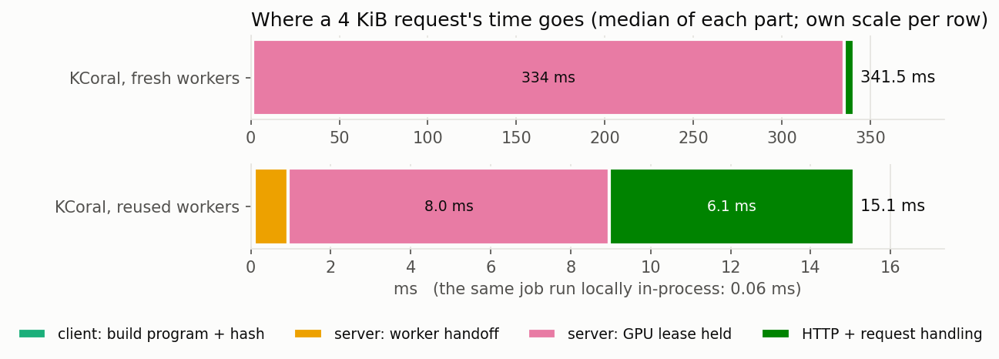
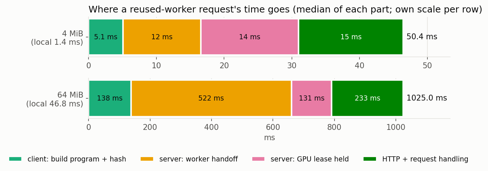
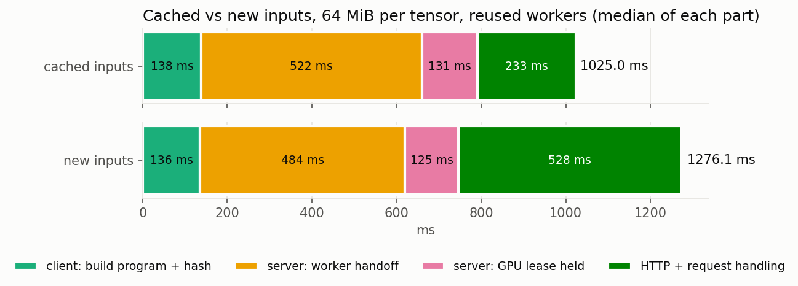
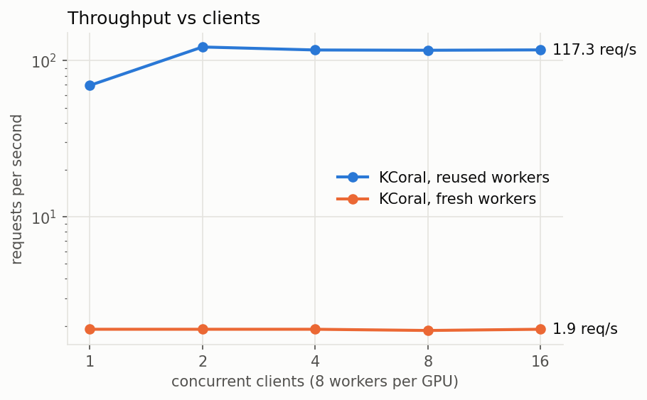

# KCoral overhead: preliminary report

This report measures how much time KCoral adds to a GPU job compared with running
the same job locally, using a minimal kernel (`c = a + b`, PyTorch, float32).

**Terms**

- **Fresh workers:** `--max-requests-per-worker 1`, the server default. Every
  request runs in a worker process that has never served a request, and the
  process exits after it.
- **Reused workers:** `--max-requests-per-worker 0`. Worker processes serve
  request after request.
- **Cached / new inputs:** whether the server's upload cache already holds the
  input tensors (keyed by SHA-256). With new inputs, the server first answers
  `CACHE_MISS` and the client resends the request with the tensor bytes.
- **GPU lease:** a worker's exclusive hold on its GPU. `lease_held_ms` and
  `lease_wait_ms` are reported by the server for each request.

## Setup

| | |
|---|---|
| GPU | NVIDIA GeForce RTX 2070 (sm_75, 8 GB, PCIe 3.0 x16), driver 595.58.03 |
| Host | AMD Ryzen Threadripper 3970X (32 cores), Ubuntu 24.04.4, Linux 6.8.0-139 |
| Software | Python 3.12, torch 2.14.0+cu130, TVM 0.27.0, KCoral `dfcf30c` |
| Server | `kcoral server` defaults on the same host as the client (loopback): one GPU, 8 workers per GPU unless stated. The **bubblewrap sandbox was off**, because AppArmor blocks unprivileged user namespaces on this host. |
| Date | 2026-10-19 |

Method:
- The local and KCoral runs execute the same Python source.
- Q1–Q3: each mode (local, KCoral with cached or new inputs) runs in its own loop:
  5 untimed warmup runs, then 50 timed runs.
- Unless stated otherwise, the client waits until all workers are ready before
  each KCoral request, so worker replacement is excluded. Q4 removes this wait.

## Open questions

1. **Q1.** How much time does one KCoral request add, and where does it go?
2. **Q2.** How does that cost grow with tensor size?
3. **Q3.** What does sending new inputs cost?
4. **Q4.** How many requests per second can one GPU serve?

## Q1. How much time does one KCoral request add, and where does it go?

**Experiment.** `benchmark/overhead.py` with 4 KiB tensors, so data transfer is negligible.
- **Local:** numpy → GPU, `a + b`, GPU → numpy, in a process whose
  CUDA context is already warm.
- **KCoral:** build the program, then `client.execute` (upload the inputs, run,
  return `c`), with cached inputs.

The breakdown uses the server's timing fields and the client's own timers:
- **client: build program + hash:** the client's time before `execute`.
- **server: worker handoff:** passing the program and its inputs to the worker
  process and the result back, both pickled through a pipe, plus workspace setup.
  Server `elapsed_ms` minus `lease_held_ms`.
- **server: GPU lease held:** `lease_held_ms`: running the program (input copies,
  kernel, result copy and hash) plus per-request cleanup.
- **HTTP + request handling:** the remaining wall time: HTTP transfer, the
  server's request handling outside the worker (parsing, blob cache) and the
  client's response decoding (hash check, copies).

Figure: `report.py: q1_fixed_cost`.

| mode | end-to-end ms: median [min, max] |
|---|---|
| local | 0.06 [0.06, 0.07] |
| KCoral, reused workers | 15.1 [11.7, 16.4] |
| KCoral, fresh workers | 341.5 [321.0, 351.7] |

**Answer.**
- **Reused workers: ~15 ms per request.** About half is GPU lease time (8.0 ms),
  although the job itself takes 0.06 ms locally, so most of it is KCoral's own
  per-request work. Most of the rest is HTTP + request handling (6.1 ms).
- **Fresh workers: ~342 ms.** Lease time grows to 334 ms, almost all of it
  spent waiting for the retiring worker process to exit (see
  [Discussion](#what-limits-fresh-workers)).

## Q2. How does that cost grow with tensor size?

**Experiment.** `benchmark/overhead.py` with 4 MiB and 64 MiB per tensor (4 KiB is
Q1): two inputs uploaded and one output of the same size returned, cached
inputs, reused workers. Same breakdown as Q1. Figure: `report.py: q2_size_scaling`.

**Answer.** Data handling dominates from a few MiB up. At 64 MiB per tensor a
request takes 1025 ms versus 47 ms locally:
- 138 ms: the client hashes 128 MiB of inputs (SHA-256, ~1 GB/s).
- ~520 ms: the server hands 192 MiB to and from the worker process, mostly
  pipe transfer (see [Discussion](#what-the-worker-handoff-costs)).
- 131 ms: the GPU lease. Beyond the copies the local job also makes (~47 ms) and
  the fixed ~8 ms, the worker copies the 64 MiB result into `bytes` and hashes it
  (~75 ms) before releasing the lease.
- ~230 ms: the 64 MiB result is returned over HTTP and decoded.

Fresh workers add about the same time per size (+1005 ms vs +1010 ms from 4 KiB
to 64 MiB) on top of their fixed cost.

## Q3. What does sending new inputs cost?

**Experiment.** `benchmark/overhead.py` also sends the request with new tensor
contents every time. It misses the upload cache, gets `CACHE_MISS`, and is resent
with the bytes. Reused workers, same breakdown as
Q1, on a shared scale. Figure and table: `report.py: q3_new_inputs`.

End-to-end ms, reused workers (medians):

| tensor | cached inputs | new inputs | extra |
|---|---|---|---|
| 4 KiB | 15.1 | 19.9 | +4.8 |
| 4 MiB | 50.4 | 72.9 | +22.6 |
| 64 MiB | 1025.0 | 1276.1 | +251.1 |

**Answer.** New inputs add one extra round trip plus the upload, all in
"HTTP + request handling": about 2 ms per MiB uploaded over loopback.
Fresh workers pay somewhat more (+14, +30 and +328 ms). The first request after
server start was at most 190 ms slower than the new-input median, so there is no
large cold-start penalty: workers set up CUDA before the server reports ready.

## Q4. How many requests per second can one GPU serve?

**Experiment.** `benchmark/throughput.py`: C clients (1–16) each send the 4 KiB request
with cached inputs back to back. After a 5 s warmup, each level is measured for 30 s.
Unlike Q1–Q3, clients do **not** wait for workers between requests, so fresh workers
are replaced while requests keep arriving. Figure and table: `report.py: q4_throughput`.

At 16 clients the GPU always has a request waiting, so the time between requests
(1000 / req/s) is what each request costs the GPU:

| workers | req/s | ms per request | of which GPU lease held | rest |
|---|---|---|---|---|
| reused | 117.3 | 8.5 | 8.3 | 0.2 |
| fresh | 1.90 | 526 | 384 | 143 |

**Answer.**
- **Reused workers: ~117 req/s from 2 clients up.** The request's own GPU lease
  fills almost all of the time per request. For this trivial kernel, that lease
  time is KCoral's own per-request work (Q1), not the kernel.
- **Fresh workers: ~1.9 req/s, even with one client.** Each request costs the GPU
  ~380 ms of lease, mostly the worker exit, plus ~140 ms while the replacement
  worker starts up. More workers per GPU do not help beyond 8
  ([Discussion](#what-limits-fresh-workers)).
- Beyond these limits, extra clients only wait: latency ≈ C / throughput.

## Discussion

### What limits fresh workers

#### Latency: process teardown

A retiring worker keeps the GPU lease, and the server sends the response only
after the worker process has exited and passed its exit checks
(`Worker._run_in_workspace` → `_wait_for_exit`; introduced by #102 and #59). In
Q1 this makes the lease held time 334 ms with fresh workers versus 8.0 ms with
reused ones, so ~325 ms per request is process teardown (Python finalization,
CUDA context destruction, OS cleanup). Responding before teardown, while still
holding the lease, would remove this from latency, but not from throughput: the
GPU stays reserved either way.

#### Throughput: worker start-up

After the teardown, the replacement worker sets up CUDA, also under the GPU lease,
one worker at a time per GPU (`GPULeases.initialization`); a single client sending
back to back waits ~126 ms for it (Q4). The server can run more fresh workers per
GPU. Same requests as Q4 with 16 clients, varying `--workers-per-gpu`. Table:
`report.py: discussion_workers`.

| workers per GPU | req/s | worker restart, s (retired to ready again) |
|---|---|---|
| 1 | 0.27 | 3.2 |
| 2 | 0.53 | 3.2 |
| 4 | 1.10 | 3.3 |
| 8 | 1.93 | 3.7 |
| 16 | 1.97 | 7.4 |

Each worker serves one request and takes ~3.2 s to come back, so up to 8 workers
serve about W / 3.6 s. From 8 workers up, the GPU lease time per request is the
limit (~2 req/s, Q4), and extra workers only wait longer for it before they are
ready. Faster worker start-up would therefore help only with few workers per GPU.

### What the worker handoff costs

The server pickles the program, input bytes included, through a `multiprocessing`
pipe to its worker, and the worker sends the result back the same way.
`benchmark/pipe_cost.py` times a bare pipe moving the same bytes, without KCoral
or a GPU (medians of 20 runs, ms). Table: `report.py: discussion_pipe_cost`.

| tensor | bare pipe: inputs | bare pipe: inputs + result | handoff, fresh workers | handoff, reused workers |
|---|---|---|---|---|
| 4 KiB | 0.0 | 0.0 | 1.1 | 0.9 |
| 4 MiB | 6.1 | 5.5 | 17.0 | 11.5 |
| 64 MiB | 339.8 | 495.3 | 322.7 | 521.7 |

At 64 MiB the pipe accounts for nearly all of the handoff. Fresh workers match
the inputs-only column because they send their result while still holding the
GPU lease, so it is counted there. Passing tensors through shared memory instead
of the pipe would likely remove most of this cost.

### What reused workers give up

Requests on a reused worker share one Python process. `benchmark/reuse_state.py`
uses a server with one reused worker: one request leaves state behind, the next
request inspects it, then a device-side assert breaks the CUDA context and the
following request inspects again. Table: printed by `benchmark/reuse_state.py`.

| state left by a request | next request, same worker | after a CUDA fault |
|---|---|---|
| worker process | same | new |
| tensor attached to the `torch` module (256 MiB) | carried over | cleared |
| monkeypatched `Tensor.__add__` | carried over | cleared |
| raw `cuMemAlloc`, outside torch (512 MiB) | carried over | cleared |
| `torch.backends.cudnn.benchmark` | cleared | cleared |
| environment variable | cleared | cleared |

KCoral resets torch settings and environment variables between requests, but
objects on imported modules, monkeypatches and GPU memory allocated outside torch
carry over to the next request on a reused worker. A request that breaks the CUDA
context fails, and its worker is replaced. Fresh workers pay ~0.3 s per request
and a ~2 req/s ceiling per GPU for full isolation, which suits untrusted kernels; reused
workers suit trusted, high-volume work.

## Summary

- **Q1.** A request adds ~15 ms with reused workers and ~342 ms with the
  default fresh workers. The difference is the wait for the retiring worker
  process to exit.
- **Q2.** For large tensors, data handling dominates: +1.0 s at 64 MiB per tensor.
  The largest part, ~520 ms, is handing tensors to and from the worker process.
- **Q3.** New inputs cost one extra round trip plus ~2 ms per MiB uploaded.
  There is no separate first-request penalty.
- **Q4.** One GPU serves ~117 req/s with reused workers and ~1.9 req/s with fresh
  workers, even with one client. Both limits are the GPU lease time per request;
  with fresh workers it includes the worker exit and the replacement's start-up,
  so more than 8 workers per GPU do not help.

Candidate follow-ups for maintainers:
- respond before worker teardown (Discussion)
- pass large tensors to the worker through shared memory, sending only a handle through the pipe, instead of pickling them through it (Q2, Discussion)
- export returned tensors without the extra `bytes` copy, and hash them after releasing the GPU lease (~75 ms of the 131 ms lease at 64 MiB, Q2)
- explain the fixed ~8 ms of lease per reused-worker request for a 0.06 ms job (Q1), e.g. the child-process check reads `/proc` for each of the worker's ~68 threads

## Limitations

- **Sandbox off:** the bubblewrap sandbox was disabled, so its cost is not
  included.
- **Same host:** client and server ran on one host over loopback, with no real
  network.
- **One configuration:** one GPU model (RTX 2070, PCIe 3.0) and one simple
  PyTorch kernel.

Reproduction steps and the file-to-section map are in [README.md](README.md).

## References

- [KCoral blog post](https://blog.mlc.ai/2026/10/05/kcoral-lightweight-benchmark-server-for-agentic-gpu-programming): kernel-time fidelity and throughput on realistic workloads (B200).
